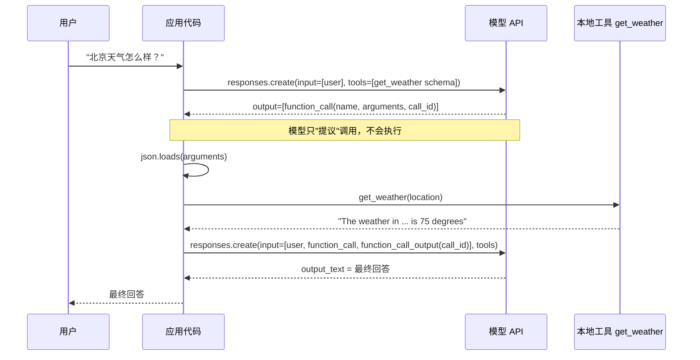
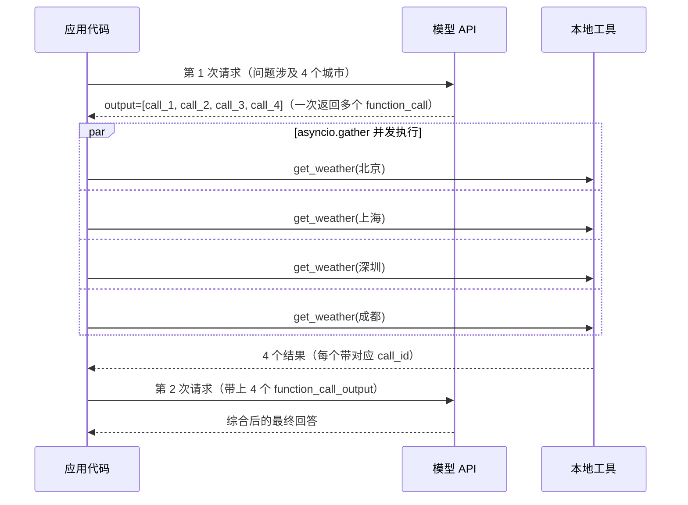

# Day 06 笔记：Function Calling（上）

## 时序图：单次工具调用闭环

## 时序图：并行工具调用

## 并行调用实测（`tool_demo_parallel.py`）
问题："请分别告诉我北京、上海、深圳、成都的天气。"

| 执行方式 | 工具耗时（每个工具模拟 1s） |
|---|---|
| 串行 `for` 循环 | 4.00s |
| `asyncio.gather` 并发 | 1.00s |

- 模型**一次响应**里返回了 4 个 `function_call`，不需要 4 轮对话。
- 每个 `function_call_output` 必须带对应的 `call_id`，模型靠它把结果和调用配对。
- 串行耗时是各工具之和，并发耗时约等于最慢那个。工具是网络请求时收益更明显。

## 两种"并行"不要混淆
1. `tool_demo_1.py`：用 `TaskGroup` 同时发起 6 个**独立对话**，是请求级并发。
2. `tool_demo_parallel.py`：**同一次对话**里模型一次发起多个调用，是工具级并行。

## 兜底（`run_call`）
错误都当作"工具结果"回传给模型，而不是让程序崩溃：
- 未知工具名 → `Error: unknown tool ...`
- 参数 JSON 解析失败、参数名不对、工具抛异常 → `Error: <异常类型>: ...`

模型看到错误文本后可以修正参数重试或向用户解释，这是 Day 07 "错误回传与自我修正"的基础。

## 要点
- 模型只提议，真正执行在自己的代码里，权限和安全边界由代码把守。
- `description` 的质量决定模型是否选对工具。
- 响应里的 `reasoning` 等项要原样放回 `input_list`，不要过滤。
